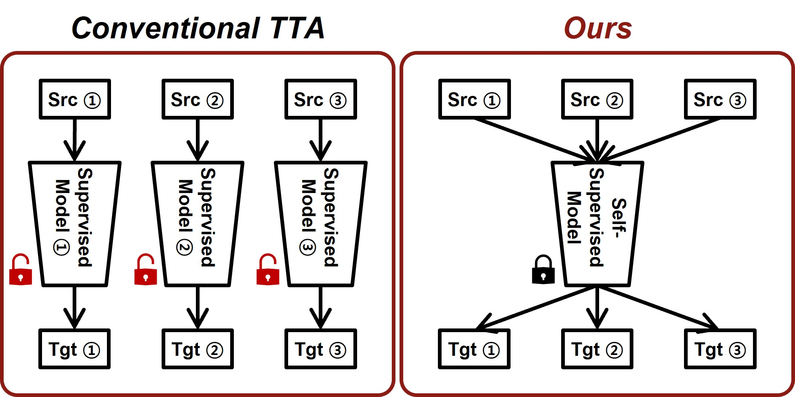

# When Test-Time Adaptation Meets Self-Supervised Models

[](https://arxiv.org/abs/2506.23529)

This repository provides the official implementation of **When Test-Time Adaptation Meets Self-Supervised Models (AWS)**, accepted at **WACV 2027**.

Our method enables test-time adaptation of self-supervised models under distribution shifts. We evaluate AWS on CIFAR-10-C, CIFAR-100-C, and ImageNet-C.

<p align="center">
  
</p>

This README provides environment setup, checkpoint preparation, and instructions for reproducing the experiments.

## Environment
Please create and activate the following conda environment.
```bash
# It may take several minutes for conda to solve the environment
conda update conda
conda env create -f environment.yml
conda activate aws
```

## Setup
### Dataset Structure
Ensure that your dataset directory follows the structure below before running the experiments.
```text
cifar/
└── data/
    ├── CIFAR-10-C/
    └── CIFAR-100-C/
imagenet/
└── data/
    └── ImageNet-C/
```
### Model Checkpoints

This repository does not redistribute pretrained model checkpoints. Download them from the original repositories listed below and place them in the corresponding directories.

#### Supervised CIFAR Checkpoints

The supervised source models for CIFAR-10 and CIFAR-100 are provided by the [ViDA repository](https://github.com/Yangsenqiao/vida). Download the source-model checkpoints linked under the `Cifar10-to-Cifar10C task` and `Cifar100-to-Cifar100C task` sections of the ViDA README.

#### Self-Supervised Checkpoints

The MoCo and iBOT checkpoints used in this project are available in the `Supervised and Self-supervised Checkpoints` section of the [HiDe-Prompt repository](https://github.com/thu-ml/HiDe-Prompt). Download the MoCo and iBOT1k checkpoints.


If necessary, rename the downloaded files to `moco.pth` and `ibot1k.pth`. The same checkpoints may be copied or symbolically linked into both the `cifar/ckpt/` and `imagenet/ckpt/` directories. Please refer to the original repositories for their checkpoint licenses and terms of use.

#### Prototype Generation

Generate full-data and 30-shot prototypes for `dino`, `moco`, and `ibot1k`. Run each block from the repository root; the loops below generate every required file.

```bash
cd cifar
mkdir -p ckpt_proto/cifar10 ckpt_proto/cifar100
for model in dino moco ibot1k; do
  python prototype_cifar10.py --model_opt "$model" --file "ckpt_proto/cifar10/${model}_full.npy"
  python prototype_cifar10_fs.py --model_opt "$model" --file "ckpt_proto/cifar10/${model}_30shot.npy"
  python prototype_cifar100.py --model_opt "$model" --file "ckpt_proto/cifar100/${model}_full.npy"
  python prototype_cifar100_fs.py --model_opt "$model" --file "ckpt_proto/cifar100/${model}_30shot.npy"
done
```

For ImageNet, first set `imagenet_root` in `prototype.py` and `prototype_fs.py` to the ImageNet directory containing `train/` and `val/`.

```bash
cd imagenet
mkdir -p ckpt_proto
for model in dino moco ibot1k; do
  python prototype.py --model_opt "$model" --file "ckpt_proto/${model}_full.npy"
  python prototype_fs.py --model_opt "$model" --file "ckpt_proto/${model}_30shot.npy"
done
```

#### Directory Structure

After downloading the model checkpoints and generating the prototype files, the directories should have the following structure:

```text
cifar/
├── ckpt/
│   ├── cifar10.t7
│   ├── pretrain_cifar100.t7
│   ├── moco.pth
│   └── ibot1k.pth
└── ckpt_proto/
    ├── cifar10/
    │   ├── dino_full.npy
    │   ├── dino_30shot.npy
    │   ├── moco_full.npy
    │   ├── moco_30shot.npy
    │   ├── ibot1k_full.npy
    │   └── ibot1k_30shot.npy
    └── cifar100/
        ├── dino_full.npy
        ├── dino_30shot.npy
        ├── moco_full.npy
        ├── moco_30shot.npy
        ├── ibot1k_full.npy
        └── ibot1k_30shot.npy
imagenet/
├── ckpt/
│   ├── moco.pth
│   └── ibot1k.pth
└── ckpt_proto/
    ├── dino_full.npy
    ├── dino_30shot.npy
    ├── moco_full.npy
    ├── moco_30shot.npy
    ├── ibot1k_full.npy
    └── ibot1k_30shot.npy
```

## Running Classification Experiments
This section provides instructions for running experiments on different datasets using test-time adaptation.
### ImageNet-to-ImageNetC task 
```bash
cd imagenet
bash ./bash/aws.sh
```
### Cifar10-to-Cifar10C task 
```bash
cd cifar
bash ./bash/cifar10/aws_vit.sh
```
### Cifar100-to-Cifar100C task 
```bash
cd cifar
bash ./bash/cifar100/aws_vit.sh
```

## Acknowledgements

This repository builds upon and uses components from the following open-source projects:

- This codebase is built upon the [official ViDA repository](https://github.com/Yangsenqiao/vida). The CIFAR-10 and CIFAR-100 supervised source checkpoints are also provided through ViDA.
- The CoTTA implementation is based on the [official CoTTA repository](https://github.com/qinenergy/cotta).
- The TENT implementation is based on the [official TENT repository](https://github.com/DequanWang/tent).
- The augmentation code uses components from the [KATANA repository](https://github.com/giladcohen/KATANA).
- Dataset and model utilities are based on [RobustBench](https://github.com/RobustBench/robustbench).
- The pretrained MoCo and iBOT checkpoints were obtained through the [HiDe-Prompt repository](https://github.com/thu-ml/HiDe-Prompt).

We thank the authors of these projects for making their code and pretrained models publicly available.
